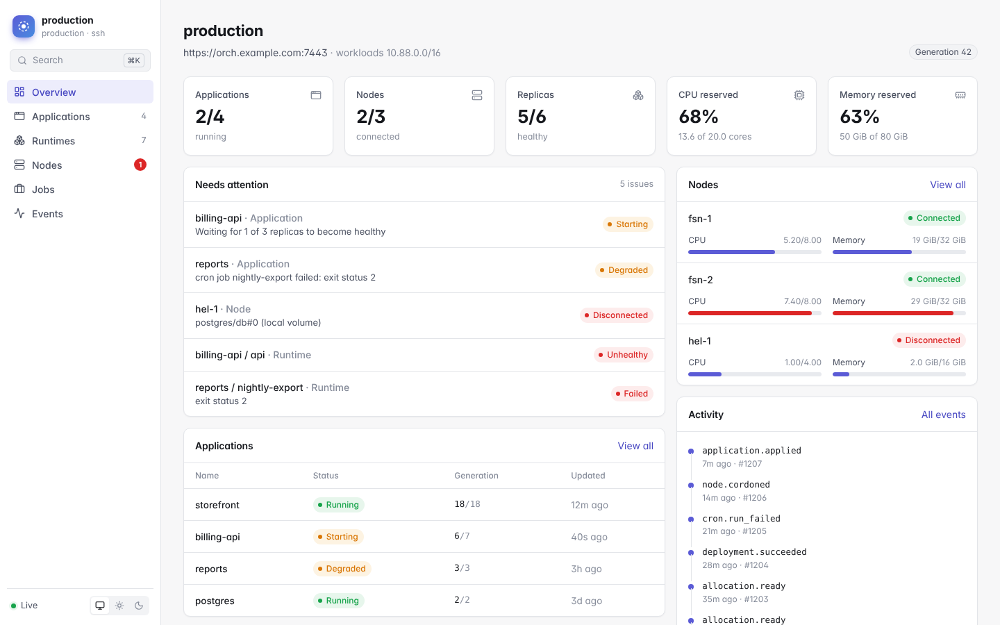
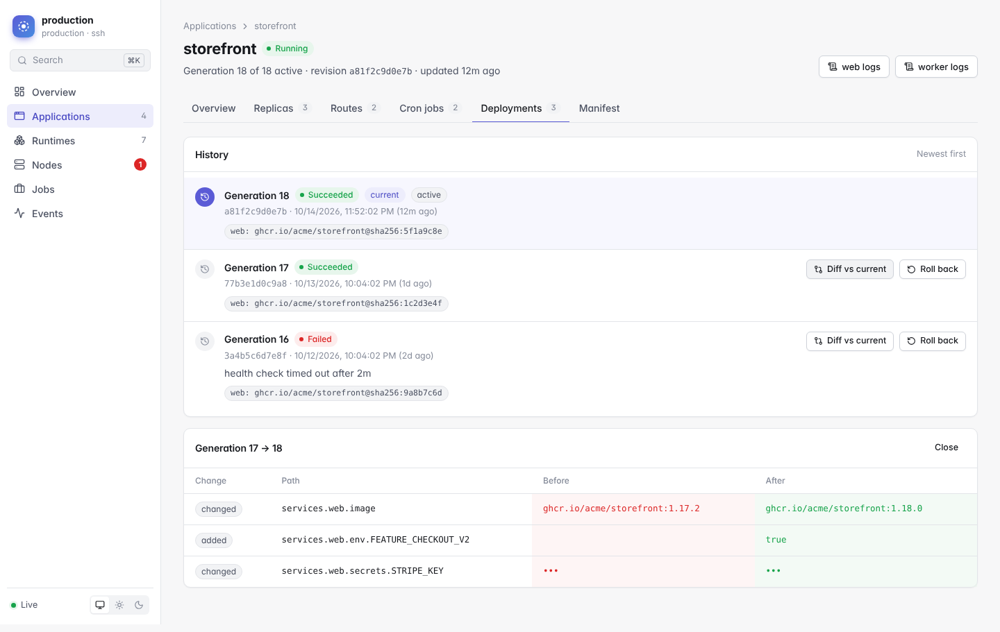

<h1 align="center">orch</h1>

<p align="center">
  Run containers on your own Linux servers.<br>
  Typed configuration, safe rollouts and HTTPS, without running Kubernetes.
</p>

<p align="center">
  <a href="https://orch.torsten.work/quick-start/">Quickstart</a> ·
  <a href="https://orch.torsten.work/docs/">Docs</a> ·
  <a href="https://orch.torsten.work/comparison/">Compared with Swarm and Kubernetes</a> ·
  <a href="https://github.com/TorstenDittmann/orch/releases/latest">Releases</a>
</p>

<picture>
  <source media="(prefers-color-scheme: dark)" srcset=".github/readme/dashboard-dark.png">
  
</picture>

## What it is

orch is a container orchestrator for one to 20 Linux hosts. It sits where
Docker Swarm used to: you turn a few servers into a cluster and deploy
applications to it. On top of that it has what you would otherwise assemble
from Kubernetes add-ons: automatic HTTPS, readiness-gated rolling updates with
rollback, an encrypted network between nodes, cron jobs, autoscaling, managed
databases and backups.

A few things set it apart:

- **Configuration in Pkl, not YAML.** Applications are described in
  [Pkl](https://pkl-lang.org), a typed configuration language. Typos, unknown
  fields and invalid combinations are caught by `orch validate` before
  anything reaches the cluster, and `orch plan` shows what a deploy will
  change.
- **Made to be operated by AI agents.** `orch mcp` is a full
  [MCP](https://modelcontextprotocol.io) server, so Claude Code, Cursor, Codex
  and other assistants can read status and logs, deploy, roll back and manage
  secrets with the same permissions you have, or a token limited to one app.
- **A dashboard included.** `orch web` opens a live dashboard in your browser.
  It runs on your machine, so there is nothing to host and no password to set
  up. `orch tui` gives you the same views in the terminal.
- **One binary.** The CLI, controller and node agent are the same `orch`
  executable. No Docker Engine is needed on the servers; workloads run on
  containerd.

## Quickstart

Install the CLI on each server and on your own machine (Linux and macOS):

```console
curl -fsSL https://raw.githubusercontent.com/TorstenDittmann/orch/main/install.sh | sh
```

On Windows: `irm https://raw.githubusercontent.com/TorstenDittmann/orch/main/install.ps1 | iex`

Create a cluster. Servers need Ubuntu 24.04+ or Fedora 42+ on amd64 or arm64;
`orch init` and `orch join` install and configure everything else.

```console
sudo orch init                                 # on the first server
orch join-token worker-1                       # prints a join command
sudo orch join orch1.eyJlIjoi...               # on each other server
orch target add production ssh://root@SERVER   # on your machine
```

Your SSH key is the credential. There are no certificates to copy around.

Describe an application in `orch.pkl`:

```pkl
amends "https://orch.torsten.work/pkl/v1/Application.pkl"

name = "shop"

services {
  ["web"] {
    image = "ghcr.io/acme/shop:1.4.2"
    replicas = 2
    resources { cpu = "500m"; memory = "256Mi" }
    http = new Http {
      port = 8080
      domains { "shop.example.com" }
      healthPath = "/healthz"
    }
    connect { ["DATABASE_URL"] = "main" }
  }
}

databases {
  ["main"] = new Postgres { version = "17" }
}
```

Then check and deploy it:

```console
orch plan
orch deploy --wait
```

orch pulls the image, pins it to a digest, starts Postgres with generated
credentials, replaces replicas one at a time once they pass the health check,
and requests a certificate for `shop.example.com`. If the new version never
becomes healthy, traffic goes back to the previous one. Both behaviors are
defaults and can be tuned in a `deploy` block.

The full walkthrough, including firewall ports and DNS, is in the
[quickstart](https://orch.torsten.work/quick-start/).

## Try it locally

With Docker Desktop, OrbStack, Colima or Docker Engine running, `orch dev`
starts a one-node cluster in a container and deploys `./orch.pkl` to it.
Services are served at `http://SERVICE.APP.localhost:8080`, and images you
built locally are used as they are. `orch dev down` stops it.
See [local development](https://orch.torsten.work/local-development/).

## Features



| | |
| --- | --- |
| **Deployments** | Plans before deploys, readiness-gated rolling updates, automatic rollback, full history, diffs between revisions, and one-command rollback to an exact earlier revision |
| **Workloads** | Services, workers, cron jobs, one-off jobs, pre-deploy hooks for migrations, CPU-based autoscaling, and local volumes |
| **Databases** | Postgres, MySQL, Redis and more, declared next to your services, with generated credentials and scheduled backups |
| **Networking** | A WireGuard mesh between nodes, service DNS, automatic HTTPS, raw TCP ingress, and node-local TCP and UDP ports |
| **Secrets** | Encrypted secrets and registry credentials that never live in the manifest |
| **CI/CD** | A GitHub Action that deploys with short-lived OIDC credentials (no stored secrets) and preview deployments for pull requests |
| **Operations** | Web dashboard, terminal UI, live logs, events, notifications to Slack, Discord or webhooks, controller backups, and managed upgrades |
| **AI agents** | A local MCP server (`orch mcp`) and a remote, OAuth-protected one for clients that connect by URL |

## How it works

One controller stores the desired state and decides where replicas run. An
agent on every node runs the workloads with containerd and runc, gives each
node its own private subnet, and connects the nodes with WireGuard. Ingress
nodes route HTTP, HTTPS and TCP traffic straight to healthy replicas. The
controller is never in the traffic path, so applications keep serving while it
is down or being upgraded.

More in [architecture](https://orch.torsten.work/architecture/) and
[core concepts](https://orch.torsten.work/concepts/).

## Is it for you?

orch is a good fit if one team runs a handful of Linux servers and wants
deploys that are checked before they run and easy to undo. It is deliberately
narrow: there is a single controller (no control-plane high availability), no
Kubernetes API, no distributed storage, and it is designed for up to 20 nodes.
If you need those, Kubernetes or Nomad is the better choice. The
[comparison](https://orch.torsten.work/comparison/) goes through this in
detail, and [running in production](https://orch.torsten.work/production/)
lists what to check before you rely on it.

The `v1` manifest schema is stable across 1.x releases; see
[compatibility](https://orch.torsten.work/compatibility/).

## Documentation

- [Installation](https://orch.torsten.work/installation/) and [quickstart](https://orch.torsten.work/quick-start/)
- [Application configuration](https://orch.torsten.work/configuration/) and the [manifest reference](https://orch.torsten.work/manifest/)
- [Deployments and rollbacks](https://orch.torsten.work/runtime/)
- [Databases](https://orch.torsten.work/databases/), [jobs](https://orch.torsten.work/jobs/), [secrets](https://orch.torsten.work/secrets/), [networking](https://orch.torsten.work/networking/)
- [Deploy from GitHub](https://orch.torsten.work/github/)
- [AI assistants and MCP](https://orch.torsten.work/ai/)
- [CLI reference](https://orch.torsten.work/cli/)
- [Operations](https://orch.torsten.work/operations/), [security](https://orch.torsten.work/security/) and [troubleshooting](https://orch.torsten.work/troubleshooting/)

Examples live in [`examples/`](examples).

## Development

orch is written in Go. [mise](https://mise.jdx.dev) installs the pinned
toolchain:

```console
mise install
mise exec -- make build      # builds bin/orch
mise exec -- make check      # formatting, vet, generated code and tests
```

Tests that need a real containerd, network and Caddy setup run with
`make containerd-e2e` on a dedicated Linux host; see
[runtime verification](docs/runtime.md#privileged-runtime-verification).
Releases are built by GitHub Actions with signed checksums and build
provenance.

## License

[Apache License 2.0](LICENSE)
